# 实践课3：Pi Agent 源码安装与编译

本报告记录我在小组组织仓库 `Learning-Rate-LR/pi-hunnu-2026` 上完成的一次完整本地源码环境搭建：检查工具链、克隆源码、阅读构建配置、安装依赖、本地编译、验证构建产物，并启动源码版本完成一次真实会话。文中所有截图均为本机实际操作时截取，命令、输出和退出码都可在同一台机器上复现。

## 基本信息

| 项目 | 内容 |
|---|---|
| 姓名 / 拼音 | 占竞 / zhanjing |
| 学号 | 202430224058 |
| GitHub 登录名 | Jing-Zhan |
| 小组组织 | <https://github.com/Learning-Rate-LR> |
| 小组组织仓库 | <https://github.com/Learning-Rate-LR/pi-hunnu-2026> |
| 实际 clone 地址 | <https://github.com/Learning-Rate-LR/pi-hunnu-2026.git> |
| 本地目录 | `D:\大三上作业\系统设计与分析\pi-hunnu-2026` |
| 分支 / 提交编号 | `main` / `1e0fe20497ede31346957636d1ee38a2e61f69d0` |
| 源码版本 | `0.86.1`（`packages/coding-agent/package.json` 的 `version`） |

实验环境：

| 工具 | 实际版本 | 用途 |
|---|---|---|
| 操作系统 | Windows 11 家庭版 25H2（10.0.26200） | 实验平台 |
| 终端 | Windows PowerShell 5.1.26100 | 所有命令的执行环境 |
| Node.js | v24.14.0 | 运行构建脚本与 Pi |
| npm | 11.9.0 | 安装依赖、执行项目脚本 |
| Git for Windows | 2.45.1.windows.1 | 下载源码 |
| 编辑器 | VS Code 1.147.0 | 阅读 `package.json` 与构建脚本 |

## 本次完成的六项任务

1. 检查并记录 Node.js、npm、Git 版本（截图 S1）。
2. 从小组组织仓库下载源码并确认来源与提交编号（截图 S2）。
3. 阅读 `package.json`，确认 `engines.node` 与 `scripts.build` 的依据（截图 S3）。
4. 在仓库根目录安装依赖，并区分警告与错误（截图 S4）。
5. 完成本地编译，检查构建产物并运行验证（截图 S5）。
6. 启动本地源码版本 `.\pi-test.bat`，完成一次真实模型会话（截图 S6）。

下文按任务顺序记录；第 7 节集中整理本次遇到的困难与解决过程（本次的重点）。

---

## 1. 任务一 实验准备：检查开发工具

在 PowerShell 中逐条执行版本检查命令：

```powershell
node --version
npm --version
git --version
```

实际输出：

```text
v24.14.0
11.9.0
git version 2.45.1.windows.1
```

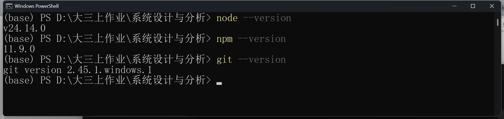

*图 1（S1）当前终端中的三个工具版本：Node.js v24.14.0、npm 11.9.0、Git 2.45.1.windows.1。*

对照要求：根 `package.json` 声明 `"node": ">=22.19.0"`，本机 Node.js 为 **v24.14.0**，属于 24 LTS 系列，满足要求，因此后续安装没有出现 `EBADENGINE` 的 Node 版本告警（第 4 节出现的 `EBADENGINE` 是另一回事：某个依赖包只允许 pnpm/yarn 安装，与 Node 版本无关）。

npm 是随 Node.js 官方安装包一起安装的，本机没有单独安装 npm；`pi` 客户端此前未在本机安装过（`~/.pi` 目录不存在），本次实验也不需要先安装全局客户端，源码版本自带同样的功能。

---

## 2. 任务二 下载课程仓库源码

### 2.1 克隆小组仓库

在 `D:\大三上作业\系统设计与分析` 下执行，把仓库克隆到本目录内，避免散落到其他磁盘：

```powershell
git clone --branch main https://github.com/Learning-Rate-LR/pi-hunnu-2026.git
```

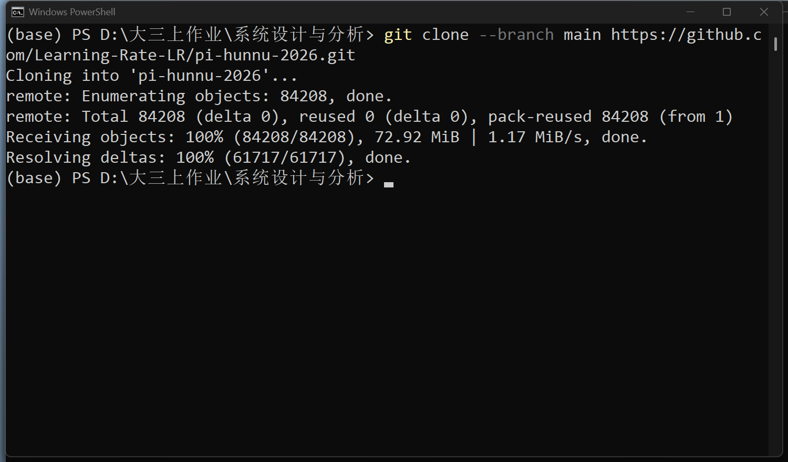

*图 2（S2）从 `Learning-Rate-LR/pi-hunnu-2026.git` 克隆，共接收 84208 个对象、72.92 MiB。*

### 2.2 确认源码来源和版本

```powershell
cd pi-hunnu-2026
Get-Location
git remote -v
git branch --show-current
git rev-parse HEAD
git status --short
git status -sb
```

实际输出（`git status --short` 无输出，表示工作区干净）：

```text
D:\大三上作业\系统设计与分析\pi-hunnu-2026

origin  https://github.com/Learning-Rate-LR/pi-hunnu-2026.git (fetch)
origin  https://github.com/Learning-Rate-LR/pi-hunnu-2026.git (push)
main
1e0fe20497ede31346957636d1ee38a2e61f69d0
## main...origin/main
```

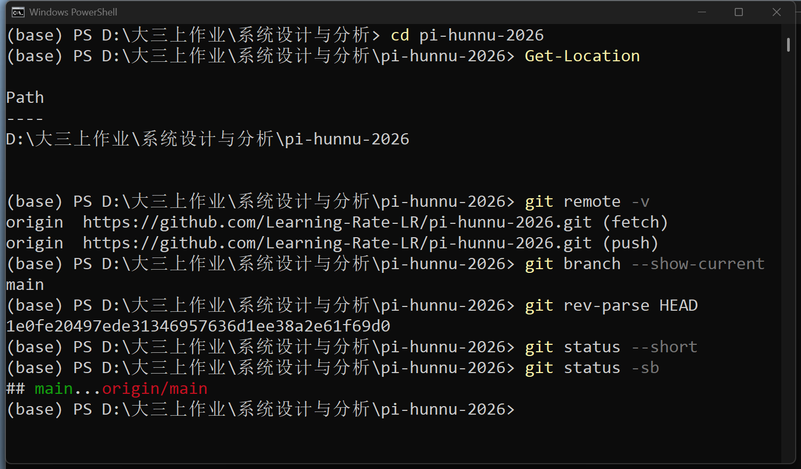

*图 3（S2）当前目录、远端地址、分支、完整提交编号，以及干净的工作区状态。*

要点说明：

- `origin` 指向**小组组织**内的仓库，不是个人账号下的仓库，也不是教师仓库；
- 当前分支为 `main`，本地与 `origin/main` 同步；
- 完整提交编号 `1e0fe20497ede31346957636d1ee38a2e61f69d0` 是本次实验的唯一版本标识，后续所有安装与构建都在这个提交上完成。

> 仅打开 GitHub 网页不能证明源码已经下载到本地，因此这里用 `git remote -v`、`git rev-parse HEAD` 的输出作为证据。

---

## 3. 任务三 阅读配置，确认安装与编译的依据

用 VS Code 打开仓库根目录，重点查看 `README.md`、`package.json`、`package-lock.json`、`packages/` 与 `packages/coding-agent/package.json`。

### 3.1 `scripts.build` 的定义

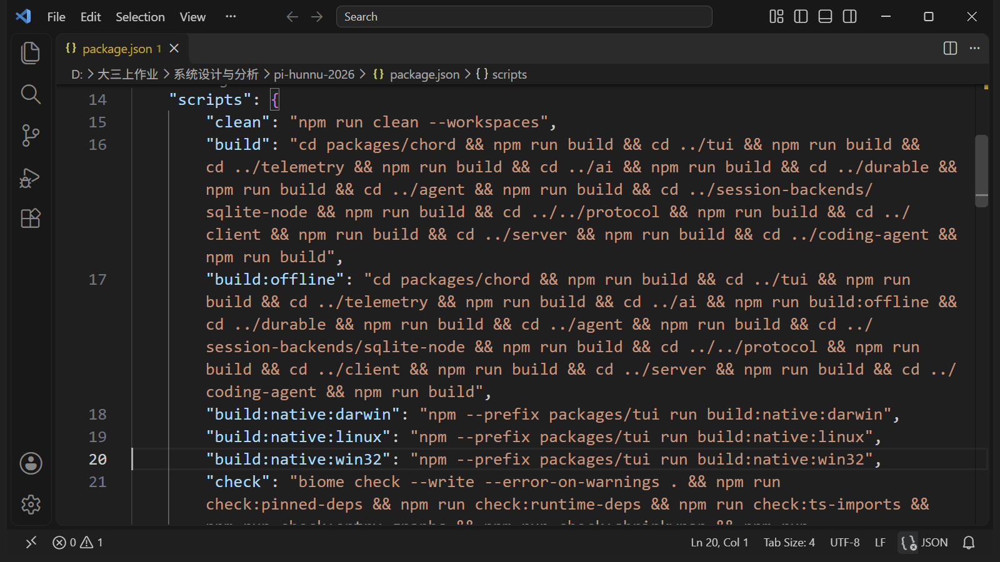

*图 4（S3）根 `package.json` 第 14 行 `scripts`，第 16 行 `build`，第 17 行 `build:offline`（长命令自动换行）。*

`build` 的实际内容（来自第 16 行）：

```json
"build": "cd packages/chord && npm run build && cd ../tui && npm run build && cd ../telemetry && npm run build && cd ../ai && npm run build && cd ../durable && npm run build && cd ../agent && npm run build && cd ../session-backends/sqlite-node && npm run build && cd ../../protocol && npm run build && cd ../client && npm run build && cd ../server && npm run build && cd ../coding-agent && npm run build"
```

### 3.2 `engines.node` 的定义

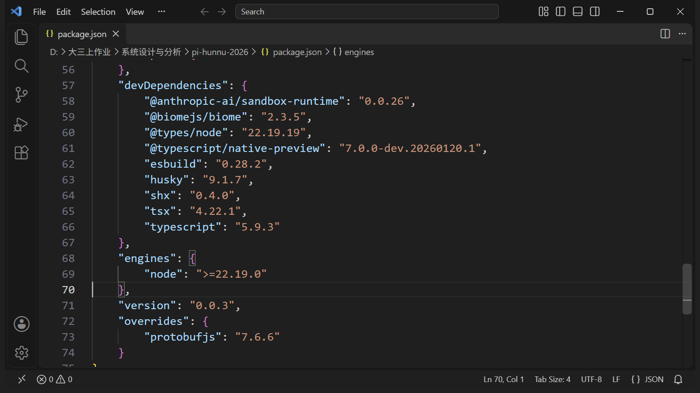

*图 5（S3）第 68–69 行：`"engines": { "node": ">=22.19.0" }`。*

```json
"engines": {
  "node": ">=22.19.0"
}
```

### 3.3 回答报告要求的两个问题

**问题一：Node.js 版本要求在哪里？**

在仓库根目录 `package.json` 的 `engines.node` 字段里，值为 `>=22.19.0`（图 5，第 68–69 行）。它只是 npm 在安装时给出的告警依据，不会自动阻止安装；各子包和第三方依赖还有各自的要求，所以最终以安装日志中的 `EBADENGINE` 为准。

**问题二：`npm run build` 实际从哪里读取命令？**

从**当前目录所在包的 `package.json` 的 `scripts` 字段**读取：本次在仓库根目录执行，npm 找到根 `package.json`，读出 `scripts.build` 那一行字符串，交给 `cmd.exe /d /s /c` 执行。所以 `npm run build` 本身不做任何编译，它只是"按配置调命令"：

```text
npm run build
  → 读根 package.json 的 scripts.build
  → cd packages/chord && npm run build   （进入子包，再读子包自己的 package.json 的 scripts.build）
  → cd ../tui && npm run build
  → ...
  → cd ../coding-agent && npm run build
```

`&&` 表示前一步成功后才继续下一步，因此任何一个子包构建失败，整条链立即终止并返回非 0 退出码（第 5 节的首次构建失败就是这样被发现的）。

### 3.4 仓库结构补充说明

- 该仓库用 **npm workspaces** 管理多个包：`workspaces` 声明了 `packages/*`、`packages/session-backends/*` 以及 `packages/coding-agent/examples/extensions/*` 下的示例扩展。依赖必须**从根目录安装一次**，由 npm 统一提升到根 `node_modules`，不要给每个子包分别装依赖、单独生成锁文件。
- `package-lock.json` 锁定依赖版本与依赖树，安装时优先使用锁定版本。
- `packages/coding-agent/package.json` 中 `bin.pi` 指向 `dist/bundle/cli.js`，这就是第 5 节要验证的构建产物入口。
- 根 `README.md` 的 `Development` 一节给出的开发命令与作业要求一致：`npm install --ignore-scripts`、`npm run build`、`npm run build:offline`、`npm run check`、`./test.sh`、`./pi-test.sh`。

---

## 4. 任务四 安装项目依赖

确认当前目录包含根 `package.json` 后执行：

```powershell
npm install --ignore-scripts
```

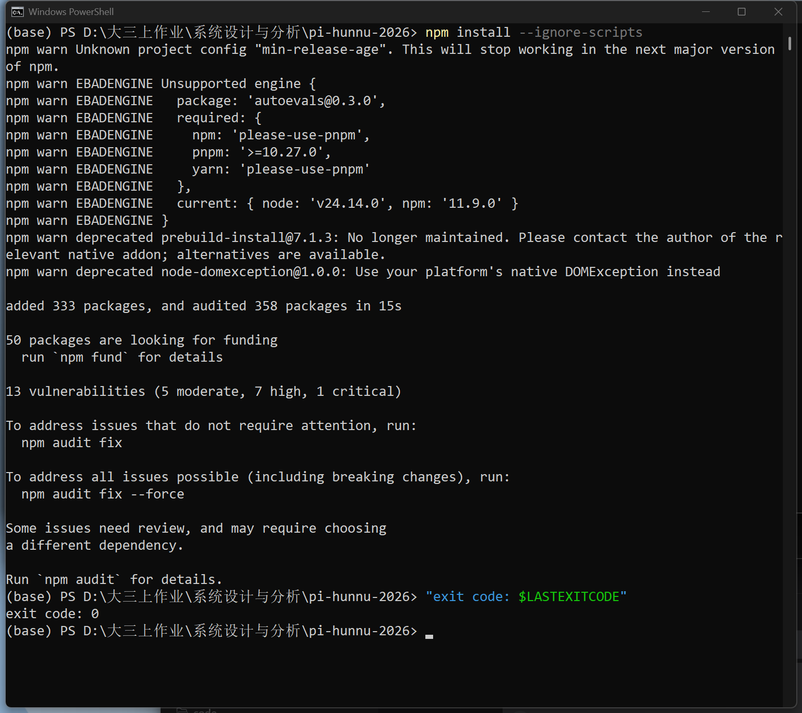

*图 6（S4）安装结束处的输出：`added 333 packages, and audited 358 packages in 15s`、13 个漏洞汇总，最后 `exit code: 0`。*

关键输出：

```text
npm warn EBADENGINE Unsupported engine { package: 'autoevals@0.3.0', required: { npm: 'please-use-pnpm', pnpm: '>=10.27.0', yarn: 'please-use-pnpm' }, current: { node: 'v24.14.0', npm: '11.9.0' } }
npm warn deprecated prebuild-install@7.1.3: No longer maintained. ...
npm warn deprecated node-domexception@1.0.0: Use your platform's native DOMException instead

added 333 packages, and audited 358 packages in 15s

50 packages are looking for funding
13 vulnerabilities (5 moderate, 7 high, 1 critical)
exit code: 0
```

### 4.1 这条命令做了什么

1. 依据根的 `package.json` 与 `package-lock.json` 解析、下载并安装依赖，锁文件与声明一致时使用锁定版本；
2. 在本地建立 `node_modules` 并关联 workspaces 中的本地包（本次为 21689 个文件、263 MB）；
3. 安装构建工具链本身，例如 `tsgo`（`@typescript/native-preview`）、`esbuild`、`typescript`、`shx`、`tsx`；
4. `--ignore-scripts` 跳过安装阶段自动触发的生命周期脚本（`postinstall`、`prepare` 等）。本仓库根 `package.json` 的 `prepare` 是 `husky`（安装 git 钩子），本次实验不需要提交钩子，跳过它既符合课程要求，也让安装过程更可控；跳过安装期脚本**不影响**后面主动执行 `npm run build`。

命令里没有 `-g`，装的是当前项目依赖，不会把本地修改后的 Pi 装成全局 `pi` 命令。

### 4.2 警告分类（区分"警告"与"错误"）

| 输出 | 类型 | 含义与处理 |
|---|---|---|
| `EBADENGINE ... autoevals@0.3.0` | 警告 | 该包的 `engines` 写的是"请用 pnpm/yarn"，当前用 npm 安装，因此提示。它**不是** Node 版本问题（`current` 里 Node 为 v24.14.0，满足根项目 `>=22.19.0`），也不影响构建，因为 `autoevals` 只被评测包 `packages/evals` 使用。 |
| `deprecated prebuild-install@7.1.3`、`node-domexception@1.0.0` | 警告 | 依赖已停止维护，属于间接依赖的提示，安装不会失败。 |
| `13 vulnerabilities (5 moderate, 7 high, 1 critical)` | 审计结果 | 本次依赖树的 `npm audit` 结果，只表示"报告了已知漏洞"，既不等于安装失败，也不等于构建失败。 |
| `exit code: 0` | 结果 | 命令成功。判断安装是否成功看退出码，而不是看警告数量。 |

**没有执行 `npm audit fix --force`**：它会为了修漏洞而升级主版本，可能改变课程使用的依赖版本，导致构建结果与课程环境不一致。这里只如实记录审计数字。

---

## 5. 任务五 本地编译与构建产物验证

### 5.1 首次构建：在 AI 包处失败

仍在仓库根目录执行：

```powershell
npm run build
```

首次构建需要联网获取**模型目录数据**（不是下载大模型权重）。`packages/ai` 的 `build` 是 `npm run generate-models && npm run build:offline`，其中 `generate-models` 会访问 `https://models.dev/api.json` 拉取最新的模型目录并生成 `src/providers/data/*.json`（该目录被 `.gitignore` 忽略，属于构建期生成物）。

本次首次构建在 `packages/ai` 的 `build:offline` 步骤失败，退出码为 1：

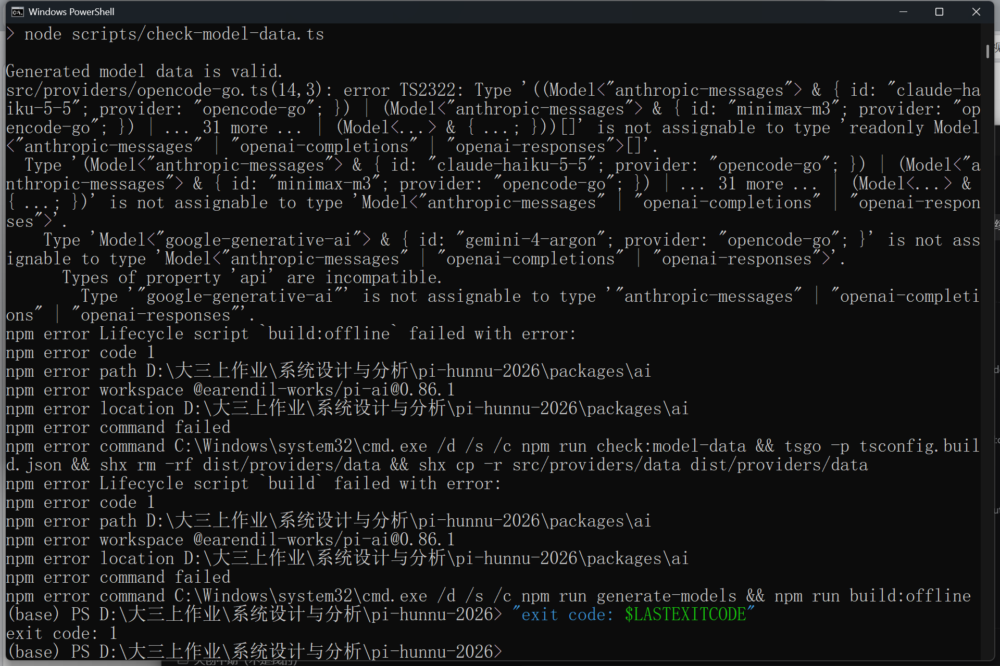

*图 7 首次 `npm run build` 的失败输出：`error TS2322`、失败的具体 workspace 与命令、`exit code: 1`。*

错误关键信息：

```text
Generated model data is valid.
src/providers/opencode-go.ts(14,3): error TS2322: Type '(...)[]' is not assignable to type
  'readonly Model<"anthropic-messages" | "openai-completions" | "openai-responses">[]'.
    Type 'Model<"google-generative-ai"> & { id: "gemini-4-argon"; provider: "opencode-go"; }'
      is not assignable to type 'Model<...>'.
        Types of property 'api' are incompatible.
          Type '"google-generative-ai"' is not assignable to type
          '"anthropic-messages" | "openai-completions" | "openai-responses"'.
```

定位过程与结论（详见第 7 节）：模型数据校验本身通过（`Generated model data is valid.`），失败发生在随后的 TypeScript 类型检查；原因不是我的环境，而是**上游模型目录发生了变化**——`models.dev` 现在把 Gemini 型号 `gemini-4-argon` 列在 `opencode-go` 之下，生成出来的 `api` 为 `google-generative-ai`，而 `packages/ai/src/providers/opencode-go.ts` 声明的 provider 只支持另外三种 API。

### 5.2 修复后重新构建：成功

修复方式见第 7 节（在生成脚本中按该文件既有风格加一条过滤规则，`git diff --stat` 为 `1 file changed, 5 insertions(+)`）。修复后再次执行同一条命令：

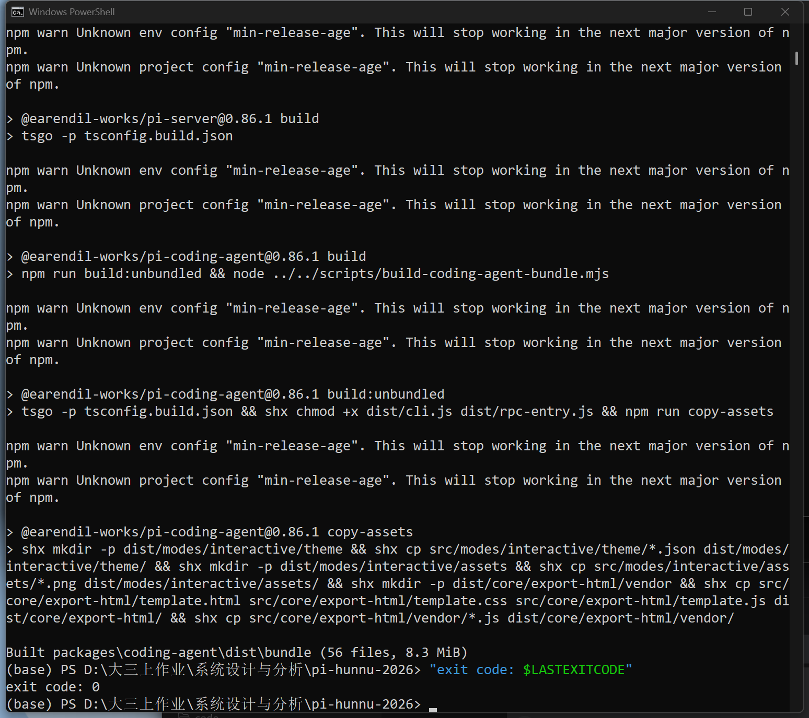

*图 8（S5）构建结束的最后一段输出：`Built packages\coding-agent\dist\bundle (56 files, 8.3 MiB)`、`exit code: 0`。*

```text
> @earendil-works/pi-coding-agent@0.86.1 build
> npm run build:unbundled && node ../../scripts/build-coding-agent-bundle.mjs
...
Built packages\coding-agent\dist\bundle (56 files, 8.3 MiB)
exit code: 0
```

构建顺序与根 `scripts.build` 一致：`chord → tui → telemetry → ai → durable → agent → session-backends/sqlite-node → protocol → client → server → coding-agent`。最后一个 `coding-agent` 先由 `tsgo` 编译成 `dist/`，再由 `scripts/build-coding-agent-bundle.mjs` 打包成单文件入口 `dist/bundle/cli.js`。

### 5.3 检查并运行构建产物

```powershell
Test-Path .\packages\coding-agent\dist\bundle\cli.js
node .\packages\coding-agent\dist\bundle\cli.js --version
```

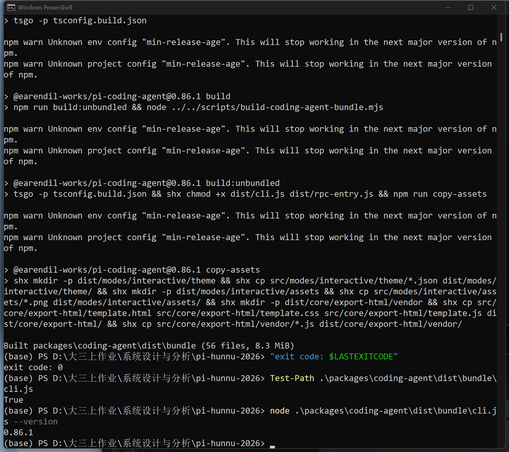

*图 9（S5）`Test-Path` 返回 `True`，直接运行产物得到的版本号为 `0.86.1`。*

| 检查项 | 结果 |
|---|---|
| 入口文件是否存在 | `True`（`packages/coding-agent/dist/bundle/cli.js`） |
| 产物规模 | 56 个文件、8.3 MiB |
| 直接运行产物的版本 | `0.86.1` |
| 根构建退出码 | `0` |

`dist` 保存构建产物，`src` 才是源码：以后修改程序应改 `src` 下的文件再重新构建；直接改 `dist` 里的文件会在下次构建时被覆盖。产物入口 `dist/bundle/cli.js` 来自 `packages/coding-agent/package.json` 的 `bin.pi` 配置。

### 5.4 后续重新构建

首次构建成功、模型目录数据已生成且仍有效后，可以用：

```powershell
npm run build:offline
```

它与 `build` 的唯一区别是 `packages/ai` 那一步改用 `npm run build:offline`，**不再联网刷新模型数据**，直接复用已有数据。它不能替代首次构建（数据缺失时会报"Model data is missing or stale"）。

---

## 6. 任务六 启动本地源码版本并完成一次会话

### 6.1 先验证源码入口

```powershell
.\pi-test.bat --version
```

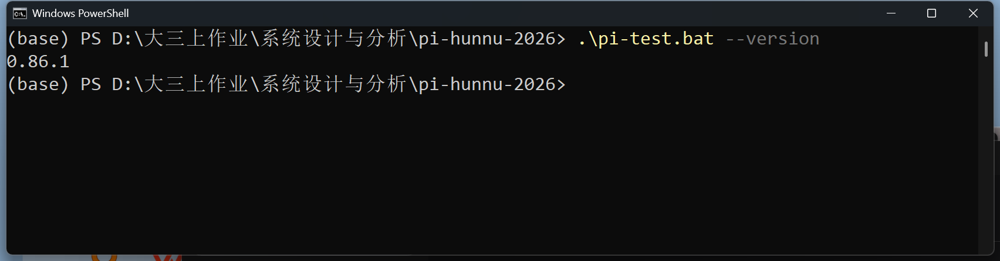

*图 10（S6）`.\pi-test.bat --version` 输出 `0.86.1`。*

`pi-test.bat` 的名字里带 `test`，但它不是"运行测试套件"，而是**运行本地源码的入口**：

```text
pi-test.bat
  → 用 powershell.exe -NoProfile -ExecutionPolicy Bypass 调用同目录的 pi-test.ps1
  → pi-test.ps1 检查 node_modules/.bin/tsx.cmd 是否存在（不存在会提示先 npm install）
  → tsx packages/coding-agent/src/cli.ts   ← 直接执行 src 下的 TypeScript 源码
```

也就是说，`.\pi-test.bat` 运行的是 `packages/coding-agent/src/cli.ts`，而第 5 节验证的 `dist/bundle/cli.js` 是编译打包后的产物，两者是不同的入口。

### 6.2 模型配置说明

本机此前没有做过 `/login`（`~/.pi` 目录当时不存在），因此本次用 Pi 支持的环境变量方式提供凭据：启动前把 DeepSeek 的 API Key 放入环境变量 `DEEPSEEK_API_KEY`（`packages/ai/src/env-api-keys.ts` 中有该 provider 环境变量的定义），启动时用 `--model` 指定具体型号：

```powershell
.\pi-test.bat --model deepseek/deepseek-flash
```

之所以显式指定型号，是因为仓库里 DeepSeek 的默认型号是 `deepseek-v4-pro`，而本机实际可用的对话型号是 `deepseek-flash`（`--list-models` 可以列出两者）。密钥只存在于终端环境变量中，截图、报告和仓库里都不出现密钥内容。

### 6.3 启动交互界面并完成一次会话

启动后 Pi 显示了版本、上下文（`AGENTS.md`）、技能（`add-llm-provider`、`find-skills`、`interactive-testing`、`release`）、提示模板（`/cl`、`/deslop`、`/is`、`/pr`、`/sa`、`/wr`）和扩展（`import-repro.ts`、`prompt-url-widget.ts`、`redraws.ts`、`tps.ts`）。发出的提示词与模型实际回复如下：

```text
请用一句话说明源码和编译产物的区别。只回答问题，不修改文件。
```

> 源码是开发者编写的可读程序代码（如 .ts 文件），编译产物是经编译器转换、供机器直接执行或部署的文件（如 .js 文件）。

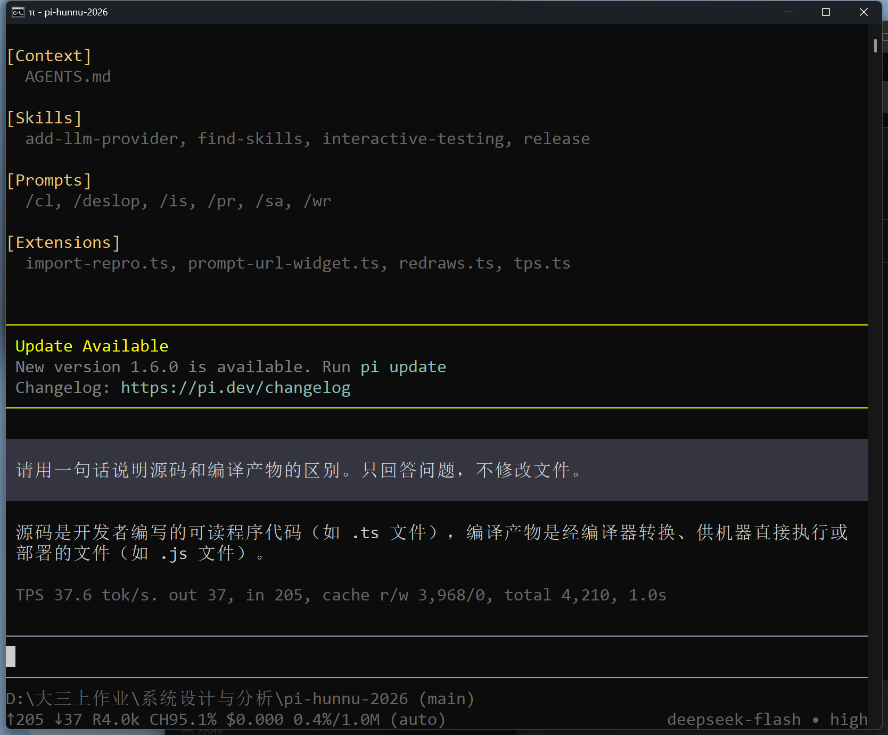

*图 11（S6）界面内可见我的提示词、模型回复、token 统计，以及底部状态栏：工作目录 `pi-hunnu-2026 (main)`、上下文用量、型号 `deepseek-flash` 与思考级别 `high`。*

### 6.4 如何确保运行的是本地源码，而不是全局安装版本

| 证据 | 说明 |
|---|---|
| 启动命令 | 刻意使用仓库根目录的 `.\pi-test.bat`，而不是输入 `pi`；后者可能命中全局安装版本 |
| 版本号 | 界面与 `--version` 都是 `0.86.1`，与仓库 `packages/coding-agent/package.json` 的 `version` 一致 |
| 升级提示 | 界面内提示 `New version 1.6.0 is available. Run pi update`，说明当前运行的不是最新发布版，而是本仓库源码版本 |
| 工作目录 | 状态栏显示 `D:\大三上作业\系统设计与分析\pi-hunnu-2026 (main)`，即本次克隆的仓库 |
| 执行路径 | `pi-test.ps1` 用 `tsx` 直接运行 `packages/coding-agent/src/cli.ts` |

配置目录是共用的：本地源码版本与全局版本都使用当前用户的 `~/.pi/agent`（本次生成了 `settings.json`、`trust.json`、`sessions/`、`bin/`）。共用配置不代表运行的是全局版本，两者是"同一份用户配置 + 不同的程序入口"。

### 6.5 两个入口分别适合什么场景

| 入口 | 运行对象 | 适用场景 |
|---|---|---|
| `.\pi-test.bat`（`tsx packages/coding-agent/src/cli.ts`） | `src` 下的 TypeScript 源码，改完立即生效 | 开发调试、读源码、改行为；启动稍慢（需要 tsx 转译），不依赖先构建 |
| `node .\packages\coding-agent\dist\bundle\cli.js` | `npm run build` 产出的打包文件 | 验证构建结果、验证发布形态、接近最终用户的使用方式；必须先构建成功 |

---

## 7. 遇到的困难与解决过程（重点）

### 7.1 困难一：首次 `npm run build` 因上游模型目录变化而失败

**现象**：严格按照课程文档执行 `npm run build`，在没有改动任何源码的干净仓库上，构建在 `packages/ai` 处失败，退出码 1（图 7）。错误是 `error TS2322`，指向 `src/providers/opencode-go.ts(14,3)`，并指出 `Model<"google-generative-ai"> & { id: "gemini-4-argon"; provider: "opencode-go"; }` 不能赋给只允许 `anthropic-messages | openai-completions | openai-responses` 的类型。

**排查过程**：

1. 先看失败发生在哪一步。日志显示 `check:model-data` 输出 `Generated model data is valid.`，说明**生成的模型数据本身合法**，失败在紧随其后的 `tsgo -p tsconfig.build.json` 类型检查。
2. 再确认仓库是否被我改动过：`git status --short` 为空、`git diff --stat` 为空，说明失败与本地修改无关。
3. 然后对比"代码声明的类型"和"生成出来的数据"：
   - `packages/ai/src/providers/opencode-go.ts` 里 provider 的类型参数写死为三种 API；
   - 构建期生成的 `packages/ai/src/providers/data/opencode-go.json` 里有 33 个型号，其中只有 `gemini-4-argon` 的 `api` 是 `google-generative-ai`。
4. 最后看数据来源：`scripts/generate-models.ts` 从 `https://models.dev/api.json` 实时拉取模型目录，并按 `@ai-sdk/google` 映射成 `google-generative-ai`。也就是说，**上游目录新增了一个 opencode-go 下的 Gemini 型号**，而这个仓库的 provider 还没有对应适配层。

**结论**：这是"构建期实时获取的外部模型目录"与"仓库内固定声明的 provider 能力"之间的不一致。首次构建需要联网取模型目录（课程文档里也提醒了这一点），而外部目录会随时间变化，同一份源码在不同时间构建可能得到不同结果。

**解决**：按该文件既有的修正风格（文件里本来就有多条针对 opencode-go 的单独修正，例如把 `minimax-m2.7`、`qwen3.5-plus` 改回 `openai-completions`），在生成脚本的 `opencode-go` 分支加一条窄规则：当型号的 API 是 `google-generative-ai` 时跳过，不生成该型号，避免产出 provider 未实现的 API 类型。

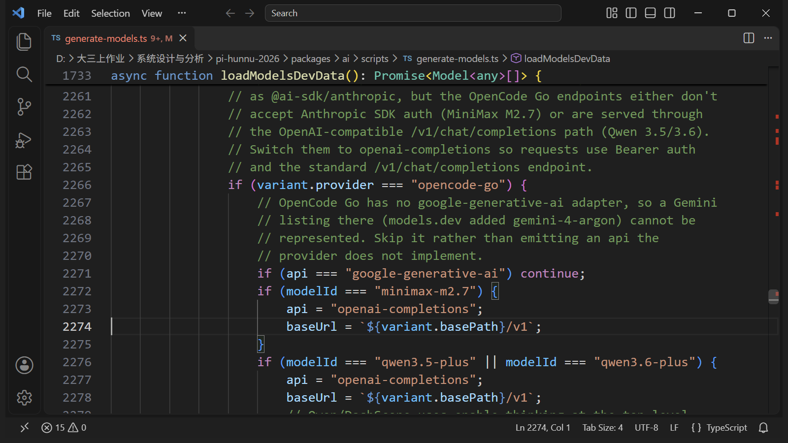

*图 12 修复位置：`packages/ai/scripts/generate-models.ts` 第 2267–2271 行（`git diff` 为 `1 file changed, 5 insertions(+)`）。*

```ts
if (variant.provider === "opencode-go") {
    // OpenCode Go has no google-generative-ai adapter, so a Gemini
    // listing there (models.dev added gemini-4-argon) cannot be
    // represented. Skip it rather than emitting an api the
    // provider does not implement.
    if (api === "google-generative-ai") continue;
```

再次执行 `npm run build`，退出码 0，产物正常（图 8、图 9）。

**验证修复确实生效**：我把这 5 行临时去掉重新构建，`error TS2322` 与退出码 1 再次出现（图 7 的截图就是这种情况的现场）；恢复这 5 行后构建成功。说明失败原因和修复手段一一对应，不是靠重试碰运气。

**取舍说明**：我没有选择 `npm audit fix --force` 或升级依赖来"消灭报错"，也没有手改 `dist` 或删除 `node_modules` 掩盖问题：前者会改变课程依赖版本，后者与报错无关。修改的是**构建期生成脚本**，并且只影响一个 model 条目，仓库其他模块的构建行为不变。

### 7.2 困难二：本机没有登录过 Pi，源码版本没有可用模型

**现象**：课程文档假设"第一次实践课已完成登录，`~/.pi/agent` 里凭据仍有效，直接 `.\pi-test.bat` 即可"。而我的机器上 `~/.pi` 目录根本不存在，直接启动会得到 "No models available"，无法完成 S6 要求的"收到模型实际回复"。

**处理**：

1. 先确认凭据应该放在哪里：阅读 `packages/ai/src/providers/deepseek.ts` 与 `packages/ai/src/env-api-keys.ts`，看到 DeepSeek provider 支持从环境变量 `DEEPSEEK_API_KEY` 读取密钥，因此不需要走浏览器 OAuth 登录也能配置模型；
2. 启动前在当前终端设置该环境变量，并用 `--list-models` 确认可用型号：

   ```powershell
   node .\packages\coding-agent\dist\bundle\cli.js --list-models deepseek
   ```

   ```text
   provider  model            context  max-out  thinking  images
   deepseek  deepseek-flash   1M       384K     yes       yes
   deepseek  deepseek-v4-pro  1M       384K     yes       no
   ```

3. 用 `.\pi-test.bat --model deepseek/deepseek-flash` 启动，成功收到回复（图 11）。

**需要注意的边界**：这样配置的是"当前终端 + 当前命令"的凭据，换一个终端窗口需要重新设置环境变量；如果以后改用 `/login` 写入 `~/.pi/agent/auth.json`，则所有入口都会复用。截图与报告中没有出现密钥内容。

### 7.3 其他记录

- **首次启动会自举工具**：源码版本第一次启动时，Pi 会检查 `fd`、`ripgrep` 是否可用，缺失就下载到 `~/.pi/agent/bin`（界面里能看到 `ripgrep not found. Downloading...`）。这一步会让首次启动明显变慢，下载完成后不再重复；它属于运行时工具自举，和"编译是否成功"无关，不能把"下载慢"当成构建失败。
- **`npm warn Unknown project config "min-release-age"`**：仓库 `.npmrc` 里的 `min-release-age=2` 在当前 npm 版本下会给出提示，只是提示，不影响安装和构建，按记录保留即可。
- **构建产物与源码的边界**：`dist` 全部由构建生成，改 `dist` 会在下次构建被覆盖；调试行为应改 `src` 并用 `.\pi-test.bat` 直接运行源码。

---

## 8. 自查：截图要求与报告内容对照

| 要求 | 应有内容 | 对应图片 | 是否完成 |
|---|---|---|---|
| S1 | 当前环境依赖版本 | `images/01-env-versions.png` | 完成 |
| S2 | 当前目录、远端地址、分支、提交编号 | `images/02-clone.png`、`images/03-repo-info.png` | 完成 |
| S3 | `engines.node` 与 `scripts.build` 定义 | `images/04-package-scripts.png`、`images/05-package-engines.png` | 完成 |
| S4 | 安装结束输出，区分警告与错误 | `images/06-npm-install.png` | 完成 |
| S5 | 构建结束输出、退出码 0、入口存在、版本号 | `images/07-build-tail.png`、`images/08-build-verify.png` | 完成 |
| S6 | 启动命令、Pi 界面、本人提示词与模型回复 | `images/09-pi-test-version.png`、`images/10-pi-session.png` | 完成 |
| 困难记录 | 现象、定位、解决、验证 | `images/11-build-fail.png`、`images/12-generate-models-fix.png` | 完成 |

结论：源码来自小组组织仓库的 `main` 分支提交 `1e0fe20`，依赖装在仓库根 `node_modules`（由 npm workspaces 统一管理），`npm run build` 依次构建 11 个包并产出 `packages/coding-agent/dist/bundle/cli.js`（8.3 MiB），`.\pi-test.bat` 运行的版本是 `0.86.1`。上面四句话正好回答课程要求说明的"源码在哪里、依赖装在哪里、构建执行了什么、正在运行哪个版本"。

仓库内的图片均以相对路径 `images/xxx.png` 引用，可直接在 GitHub 网页查看；本报告不含任何 API Key、`auth.json` 或授权回调地址。
